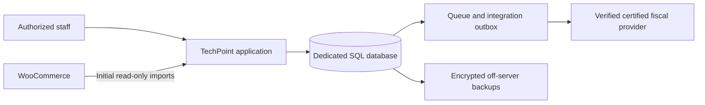

# TechPoint Business OS — Phase 0 proposal

Prepared on 14 October 2026. Decision status: **awaiting approval to begin Phase 1**. This is a requirements, architecture, and feasibility proposal. The actual VPS, business tax position, provider API, and production workflows remain discovery gates.

The recommended direction is a **Laravel modular monolith with an exact-decimal financial core**, developed independently of the existing WooCommerce site. The source workspace has no existing application or Git repository. No application code, credentials, database migration, purchase, DNS change, stock update, or fiscal submission has been made.

## 1. Understanding of TechPoint's requirements

TechPoint needs one business system for one central warehouse and several sales sources: WooCommerce, in-person, telephone/manual, and later channels. Channels must not create separate warehouses. The system must connect a product's purchase and attributable import costs to its stock movements, sale, payment, delivery, possible return/refund, accounting entries, and fiscal evidence.

The defining requirements are traceability and financial consistency: every stock change has a source and actor; posted financial facts are corrected through linked entries; external events are processed exactly once in their business effect; the accountant has explicitly granted access; and reports reconcile to posted transactions. EUR is the base currency, Albanian is the initial language, and the interface uses TechPoint navy `#11273c` with compact, accessible forms and tables.

Revenue, gross profit, operating profit, net profit, cash flow, receivables, payables, and inventory assets have distinct definitions. Inventory acquisition is not automatically a profit-and-loss expense. Recoverable import VAT is not automatically a permanent product cost. A money refund does not by itself prove that goods have returned.

The full roadmap covers dashboard, catalog/warehouse, suppliers/purchasing/imports, multichannel sales, expenses/payments/cash flow, double-entry accounting, fiscal integration, POS/printing/barcodes, WooCommerce, returns/courier reconciliation, roles/auditing/backups, reports, and later optional AI analytics. AI data egress and automatic financial or stock actions are outside the approved first-release scope.

The [public storefront](https://techpoint-ks.com/) was readable during a single read-only inspection. That observation does not test checkout, authenticated WooCommerce APIs, stock accuracy, or continuous uptime.

## 2. Custom application versus ERPNext

| Decision factor | Custom Laravel application | ERPNext with a separate extension app |
| --- | --- | --- |
| Existing business functionality | Purchasing, stock, accounting, and returns require implementation and validation | Existing accounting, stock, purchasing, and landed-cost workflows reduce new work |
| Strict financial arithmetic | Exact decimal calculations can be enforced throughout | Current native calculations use Python floating point |
| TechPoint interface/workflows | Full control over Albanian UX, channel attribution, courier settlement, and allocation rules | Configuration and extensions; localization and workflow fit require practical validation |
| Kosovo fiscalization | Authorized provider integration still required | Authorized provider integration still required |
| Long-term maintenance | TechPoint owns financial logic, tests, integrations, dependencies, and upgrades | Upstream maintains much of the core; TechPoint owns extensions, integration tests, and upgrade compatibility |
| Main cost/risk | Higher development effort and custom-accounting risk | Fit gaps and customization risk; a core fork increases upgrade burden |

ERPNext would ordinarily be a strong candidate because it already documents [accounting workflows](https://docs.frappe.io/erpnext/accounting-introduction) and [landed-cost vouchers](https://docs.frappe.io/erpnext/landed-cost-voucher). However, verified release code uses floating point in [Frappe's numeric utility](https://raw.githubusercontent.com/frappe/frappe/v16.51.0/frappe/utils/data.py) and [ERPNext's item/tax/currency calculations](https://raw.githubusercontent.com/frappe/erpnext/v16.50.0/erpnext/controllers/taxes_and_totals.py). Decimal database columns do not remove that conflict with the brief's mandatory arithmetic rule.

**Recommendation under the requirements as written: custom Laravel.** Do not create an invasive ERPNext financial fork to mask the mismatch. If the arithmetic requirement is explicitly revised later, revisit an ERPNext fit assessment before funding a complete custom ledger. This conclusion does not imply that ERPNext is generally unsuitable for accounting.

## 3. Recommended architecture

| Layer | Proposed selection | Purpose |
| --- | --- | --- |
| Backend | Laravel 13, PHP 8.5, tested patches pinned | One maintainable application with established authentication, validation, queues, and migrations |
| Database | MySQL 8.4 LTS, InnoDB, utf8mb4 | Transactions, row locking, uniqueness, foreign keys, and exact decimal storage |
| Frontend | Vue 3, TypeScript, Inertia, Tailwind | Reusable Albanian forms/tables and eventual POS; static compiled assets in production |
| Financial arithmetic | Decimal value objects using a reviewed library such as Brick Math | Exact quantities, costs, FX, allocations, tax, and journal sums; money/rates travel as decimal strings |
| Background work | Database-backed queues, supervised workers, scheduler, durable inbox/outbox | Imports, retries, exports, reconciliation, and recovery without a mandatory Redis service |
| APIs | Versioned REST contracts, authenticated integrations, server policies | Explicit contracts and authorization for future integrations |
| Deployment | Ubuntu 24.04 LTS, Nginx, versioned PHP/database images through a small Compose deployment | Reproducible local/staging/production environments on one host |

The versions are proposals, not installed or tested combinations. Support dates and upgrade obligations are recorded in the hosting annex. Laravel's [Vue starter kit](https://laravel.com/framework/docs/13.x/starter-kits) supplies a supported starting structure; [Brick Math](https://github.com/brick/math) provides arbitrary-precision numbers. Financial correctness still requires our own rules, constraints, and tests.

Domains are Identity/Access, Catalog, Inventory, Purchasing/Imports, Sales, Finance, Accounting, Returns/Delivery, Integrations/Fiscal, and Reporting. Controllers and UI components delegate business operations to domain services. One posting transaction writes the required stock facts, balanced journal, audit event, projections, and outbox command. Network calls occur after commit. Stock/cost rows are locked in deterministic order; retries retain the same business idempotency key.

The diagram is the target architecture. Fiscal issuance is pending a verified provider contract; WooCommerce stock writes are disabled until a separate approved cutover. No microservices, Kubernetes, external AI service, or paid analytics service is proposed.

Security starts in Phase 1: strong password hashing, secure sessions, CSRF/input validation, rate limits, optional 2FA, server-side permission and record-scope checks, private attachments, export auditing, SQL reachable only on the internal network, restricted SSH, secrets outside Git, redacted logs, and dependency patch ownership. The application role cannot silently alter posted ledgers; migrations use a separate privileged identity. Production monitoring covers errors, queue failures, reconciliation age, disk space, TLS renewal, and backup age.

Local development and `dev-erp.techpoint-ks.com` use separate databases, credentials, and files from production. Initially use sanitized test data and a test Woo store. Any later live read-only connection must use a dedicated Read key. Creating live webhooks is a site configuration change and needs the separately authorized integration step. WooCommerce documents [read-only keys](https://developer.woocommerce.com/docs/apis/rest-api/authentication/), [v3 resources](https://developer.woocommerce.com/docs/apis/rest-api/v3/), and [signed webhooks](https://developer.woocommerce.com/docs/apis/rest-api/v3/webhooks).

Timezone correction to approve: `Europe/Pristina` was rejected by the available runtime and is absent from the checked IANA 2026e location/alias files. Show **Prishtinë** to users and use an approved supported IANA identifier representing the business clock, proposed `Europe/Belgrade`. Store instants in UTC and accounting dates separately; test local midnight and DST. This is a compatibility choice, not a change to the business location. [IANA zone data](https://data.iana.org/time-zones/tzdb-2026e/zone1970.tab), [IANA aliases](https://data.iana.org/time-zones/tzdb-2026e/backward).

## 4. Database entity and relationship proposal

| Domain | Core records and relationships |
| --- | --- |
| Access | Users ↔ roles ↔ permissions; scoped grants, audit events, private attachments |
| Catalog | Products → category, units/conversions, barcodes, supplier links, price history; unique SKU |
| Inventory | One warehouse → movements, reservations, counts, condition buckets, cost/balance projections |
| Purchasing | Supplier → order → shipment/invoice → cost components/allocations → confirmed partial receipts |
| Sales | Channel → order/lines → fulfillment, invoices, discounts, tax snapshots |
| Finance | Cash/bank accounts → payments/allocations, expenses, transfers, bank lines, recurring drafts |
| Returns/delivery | Original sale/fulfillment → return/inspection and credit/refund; courier statements → settlements/matches |
| Accounting | Accounts/periods → journal drafts → immutable balanced journals/lines → linked reversals |
| Integrations | Connection → external mappings, snapshots, inbox, jobs, checkpoints, failures, reconciliation |
| Fiscal | Frozen request → attempts → real provider confirmation/references; linked corrections and outbox |

SKU and barcode lookup do not replace stable external identity. WooCommerce mappings include connection, product/variation IDs, order/item IDs, and refund IDs. Unique source-effect keys prevent repeated stock movements, journal posting, refunds, and courier settlements.

Moving weighted-average valuation uses previous quantity/value plus the confirmed capitalizable receipt value. Each import cost category can use its own value, quantity, weight, or volume basis, with required source measurements and deterministic rounding residuals. Recoverability of VAT is effective-dated and accountant-approved.

Proposed operational transitions: accepted order reserves; dispatch consumes the reservation and deducts once; cancellation releases remaining undispatched reservations; inspected physical return restores only eligible received units; a refund settles money/credit records independently. Dispatched or failed-delivery goods cannot be restocked by releasing a reservation. Dispatch and delivery accounting depends on the approved transfer-of-control policy. COD collections remain courier receivables until remitted. Historical Woo orders stay in shadow records until an approved opening date and import treatment prevent double counting.

The full model annex specifies exact precisions, constraints, locks, partial workflows, cost adjustments, permissions, report formulas, and acceptance tests. Before financially binding operations, implement the minimal balanced posting engine; Phase 4 expands accounting rather than adding balancing retrospectively.

## 5. Fiscal research plan and verified providers

The Official Gazette records **MF No. 01/2026**, published **27 April 2026**, for fiscal devices, systems, and electronic fiscal software. The [ATK portal](https://apps.atk-ks.org/sefaplikimi) publishes current implementation materials, and its [certified register](https://apps.atk-ks.org/sefaplikimi/PublicSEF) identifies software versions/platforms. [Gazette record](https://gzk.rks-gov.net/ActDetail.aspx?ActID=119286).

The described consumer retail activity suggests fiscal obligations; TechPoint's individual treatment, transition deadline, COD issue event, and VAT position need its registration facts and accountant/ATK confirmation. The detailed research annex separates confirmed rules from conditional application and identifies official notices and technical-document limitations.

| Verified candidate | Official certification record | API/integration, cost, and limitations |
| --- | --- | --- |
| Informatika Computers / Rikont FiscalListener | v1.0.18, Windows; 15 September 2026. [ATK record](https://apps.atk-ks.org/sefaplikimi/PublicSEF/Details/20) | Third-party API/SDK/service, fees, refund/outage behavior, and XP-Q80CS support unverified |
| TECH VISION / SEF Connect | v1.0.0, Windows; 1 October 2026. [ATK record](https://apps.atk-ks.org/sefaplikimi/PublicSEF/Details/26) | Same capabilities and costs unverified; obtain versioned contract and sandbox |
| Kuleta Platform / Kuleta Terminal | v1.0.0, Windows/macOS; 27 August 2026. [ATK record](https://apps.atk-ks.org/sefaplikimi/PublicSEF/Details/18) | Standalone fiscal interface, commercial availability/fees, exports, and hardware support unverified |

These are research candidates, not compatibility recommendations. Certification of a named product does not certify our ERP or prove a supported third-party API. ATK links [public integration samples](https://github.com/fiskalizimi/pos-csharp); samples are not authorization for a custom ERP to fiscalize directly.

Next research work: capture and review the current instruction/specifications/amendment; establish TechPoint's applicable requirements; obtain candidate API and sandbox documents, written certification boundary, full fee quote, receipt numbering/status/retrieval, cancellation/partial-refund rules, outage recovery, certificate/key custody, retention, and exact printer compatibility. No provider contact is authorized or has been made.

The fiscal adapter remains pending until those gates pass. A timeout after submission is `outcome_unknown`, requiring status reconciliation before any resend. Only real supported provider confirmation marks issuance successful. Separate fiscal issuance from subsequent reporting when the approved provider's lawful offline process requires it. Internal printouts cannot serve as fiscal confirmation, and required fiscalization cannot be bypassed by normal sale completion.

The ATK-linked samples require a key pair per POS and warn that its private key must remain on the originating machine. Preserve that custody through a certified local POS/agent model; do not move till keys onto the VPS without a documented authorized alternative from ATK/the provider. This is a verified technical-model constraint, not a finding that Kosovo generally prohibits offshore ERP hosting. [ATK-linked signing sample](https://github.com/fiskalizimi/pos-csharp).

Hardware remains a separate acceptance gate: manufacturer's [XP-Q80C documentation](https://www.xprintertech.com/xp-q80c) concerns a related model, not verified XP-Q80CS compatibility; NETUM's [setup manual](https://support.netum.net/hc/en-us/articles/49408930454555-Wireless-Barcode-Scanner-Setup-Manual) includes NT-2028 variants, but the exact unit/revision and CCD description need confirmation. Standard [browser printing](https://html.spec.whatwg.org/multipage/timers-and-user-prompts.html#printing) does not guarantee silent printing or physical success. Test the actual devices, 80 mm layout, Albanian characters, QR, outages, and reprints with the selected fiscal provider.

## 6. Infrastructure and recurring costs

Official Contabo documentation lists current Core/Cloud VPS 6 with **6 shared vCPU, 12 GB RAM, 200 GB SSD, a 300 Mbit/s port, and fair-use unlimited traffic**. Retail materials also advertise a 100 GB NVMe option; the exact SKU/storage needs checkout confirmation. Ubuntu 24.04 is a proposed Linux image, not an inspected installed OS. [Contabo specifications](https://docs.contabo.com/docs/servers-hosting/vps/).

The provider advertises **€6/month**, with conflicting 12/24-month descriptions across official materials and an indexed €7.50 reference price. Direct retail-page access returned HTTP 403; selected-country checkout taxes, setup, upfront payment, renewal, and add-ons remain unverified. [Contabo Linux hosting article](https://contabo.com/blog/linux-web-hosting/), [retail page](https://contabo.com/en-us/vps/).

| Item | Preliminary cost and status |
| --- | --- |
| VPS | Advertised €6/month; €7.50 reference. Actual invoice/commitment not confirmed |
| Linux/application/database/HTTPS software | No proposed software subscription; maintenance labor is additional |
| Independent encrypted backup storage | Example B2 rate $6.95/TB/month, first 10 GB free; 50–100 GB average retained data gives about $0.28–$0.63/month before tax/FX/extra usage. Proposed paid option, requiring approval. [B2 pricing](https://www.backblaze.com/cloud-storage/pricing) |
| Fiscal software/API/certificates, print bridge | Unknown; obtain a complete written quote |
| Domain, support, accountant validation | Existing domain presumed; other fees/labor not priced |

The server target below €10/month appears plausible. A complete recurring-cost total is **not confirmed**; fiscal and maintenance costs cannot be hidden inside that claim. Existing reliable owner-controlled off-server storage may avoid a new storage subscription if automated availability and restores can be verified.

Engineering estimates assume 5–10 simultaneous staff, at most 10,000 SKUs, 100–300 orders/day, and modest attachments; replace these with TechPoint's actual volumes. Laravel working memory is approximately 2.9–5.8 GB including database/jobs/backup bursts, with substantial headroom required. Initial disk allowance is roughly 65–105 GB including headroom. Expected egress is provisionally 10–100 GB/month. These are sizing assumptions, not benchmarks or capacity promises. No actual instance has been inspected.

Backups: daily transaction-consistent database plus files/configuration copied to independent encrypted storage; proposed 7 daily/4 weekly/12 monthly recovery points, subject to legal retention requirements. Recovery keys stay outside the VPS. Proposed initial RPO is 24 hours and RTO 4 hours, requiring business approval and an actual clean-environment restore test. If a day of transactions is unacceptable, add more frequent database log/files replication before launch. Snapshots alone are insufficient. Long-term source-document retention is a separate legal/accounting policy.

After restoration, keep outbound fiscal, payment, and stock synchronization jobs paused until external confirmations, payments, open orders, and post-backup stock effects are reconciled and recovered. A restored database may lack an already issued external document or its idempotency record; replaying old jobs blindly can duplicate an irreversible operation. Include this reconciliation in the restore/rollback drill and measured recovery time.

## 7. Phases, priorities, and first release

| Phase | Work boundary | Completion evidence |
| --- | --- | --- |
| 0 | Discovery, architecture, model, costs, fiscal evidence, risks | This proposal and annexes; unresolved external/business decisions remain explicit |
| 1 | Git, reproducible runtime, migrations, authentication/roles, audit/logs, queue, private files, backups, shell | Login/session/permission tests, migration checks, redaction tests, development restore, build/start smoke test |
| 2 | Catalog, supplier/orders, shipment allocations, confirmed receipts, moving average/counts | Exact allocations/VAT handling, concurrent/replayed receipts, count/reversal and valuation reconciliation |
| 3 | Channel sales, reservation/dispatch, expenses/payments/credits/returns | No overselling/duplicate effects, partial workflows, truthful COD/cash/profit effects; balanced posting foundation |
| 4 | Full chart/journals/GL/period close/reconciliation/reports | Balance and immutability tests, close/post race tests, AR/AP/inventory/GL reconciliation, accountant validation |
| 5 | Woo read-only connector, certified fiscal adapter, POS/devices, courier settlement | Replay/out-of-order/retry tests; actual authorized fiscal sandbox and hardware tests; no live stock writes without cutover |
| 6 | Executive analytics, exports, comparisons, alerts | Filtered totals reconcile; access/CSV/Excel checks; optional AI only after data/privacy approval |
| 7 | Hardened VPS, HTTPS, restore, opening data, end-to-end runs, cutover/rollback | Acceptance evidence, actual invoice/resource check, tested restore/rollback, explicit production approval |

Fiscal provider discovery runs alongside early development after approval because it can affect sales/POS design. The phase list is a sequence of small increments, not a promise to deliver all modules in one build.

**First demonstrable release:** an isolated development system proving product → purchase/import allocation → receipt exactly once → authorized sale/return with auditable stock and balanced accounting effects. Reports use posted test records, clearly identified as development data. This is not production fiscal software. The first operational launch additionally needs the phase-7 gates and an approved lawful fiscal workflow.

Each phase ends with a report of implemented behavior, specific tests/results, limitations, open risks, and the next increment. No module is marked complete merely because its page or navigation exists. Initial receipts require finalized costing unless provisional costing and subsequent adjustments are explicitly added to the Phase 2 scope.

## 8. Main risks and mitigations

| Risk | Consequence | Mitigation / gate |
| --- | --- | --- |
| Custom accounting complexity | Incorrect profit, VAT, balances, or corrections | Accountant-approved policies; exact arithmetic; minimal posting foundation early; reconciliation and closed-period tests before use |
| Unverified fiscal API/authorization | Invalid receipts or inability to complete sales lawfully | Certified provider documentation/sandbox, written boundary, controlled pending adapter, no issuance claim without confirmation |
| Unknown external response | Duplicate fiscal document/refund | Stable identity, provider-enforced idempotency/status query, intervention for unresolved outcomes |
| Unsupported fiscal key relocation | Signing topology or certification assumptions fail | Preserve per-POS key custody; require a documented authorized alternative before centralizing keys |
| Woo and ERP both write stock | Overselling and overwritten quantities | Shadow mode first; single-writer cutover, physical reconciliation, event watermark and rollback rehearsal |
| Poor SKU/opening cost data | Wrong stock value and margins | Variation/component mapping, physical counts, invoice/cost evidence, approved opening date/balances |
| Late import costs and COD timing | Misstated COGS/inventory/revenue | Explicit provisional-cost decision and recognition policy; in-transit/courier clearing, auditable adjustments |
| Small unmanaged server | Downtime, full disk, delayed jobs/backups | Resource limits, build outside production, monitored queues/storage/backups, measured load/restore, patch owner |
| Backup unavailable or undecryptable | Permanent data loss | Independent credentials/recovery keys, monitored backups, clean-environment restore before launch and quarterly drills |
| Restore loses external confirmation records | Duplicate issuance/payment when stale jobs resume | Pause outbound jobs, recover post-backup effects, and reconcile provider/Woo/payment identities before replay |
| Excess permission/data exposure | Unauthorized finance changes or customer leakage | Server/field/scope checks, private files, audited exports, redacted logs, no unapproved external AI egress |
| Contract/device ambiguity | Budget overrun or POS failure | Actual quote/SKU and hardware verification before commitment; no silent-printing promise |
| Upgrade and staff dependency | Unsupported or unmaintained ERP | Named maintainer, pinned releases, reviewable commits, regression suite, operating/runbook ownership |

Cutover includes final site/ERP backups, inventory/open-order/payment reconciliation, clear authority, staging tests, controlled migration window, monitoring, and explicit approval. Application rollback uses compatible versioned releases/additive migrations. A data rollback must preserve and reconcile post-cutover transactions; restoring an older balance blindly is unsafe.

## 9. Questions before implementation

1. **Project and runtime:** initialize a new TechPoint repository here, or use an existing repository? Who will maintain the chosen PHP/Laravel stack? Is installing/configuring the local development runtime acceptable after Phase 1 approval?
2. **Hosting/budget:** is a VPS already purchased? Confirm exact SKU, region, storage, selected Linux OS, and tax-inclusive quote/contract. Does €10 mean VPS only or all recurring technical services?
3. **Legal/accounting:** what are the legal entity/NUI, VAT registration/effective dates, current fiscal software/device, and accountant? Who approves tax recoverability, chart of accounts, recognition rules, and closing policy?
4. **Scale/data:** number of SKUs/variations/bundles, orders per day, concurrent staff, historical import period, existing stock/cost/AR/AP records, and attachment volume?
5. **Sales/delivery:** which payment methods and couriers are used; which statement formats exist; when are goods supplied/accepted and COD collected/remitted; who currently issues the fiscal receipt?
6. **Costing:** may stock receipt wait for finalized import costs, or must Phase 2 include provisional costs and later adjustments? Are pack conversions, weights, and volumes available?
7. **Devices/fiscal provider:** exact XP-Q80CS and NT-2028 revisions/interfaces, workstation OS, number of tills, and any existing provider contract/API documents? Commercial/technical responses from candidates are needed before adapter implementation.
8. **Access/operations:** accountant scope, stock/refund/discount/posting approval limits, DNS/server owner, patch/alert owner, and approved independent backup location? Are RPO 24 hours/RTO 4 hours acceptable?
9. **Time and architecture:** approve the supported timezone mapping displayed as Prishtinë and the proposed Laravel/MySQL/Vue architecture?

Credentials should be provisioned through protected local/server secret configuration later, not pasted into chat or committed to Git. Business/provider answers can be supplied incrementally, but decisions affecting a module must be resolved before that module is implemented or released.

## Supporting deliverables and discovery status

- [Stack, hosting, support dates, and cost evidence](phase0-stack-hosting.md)
- [Logical entities, transaction policies, report definitions, and acceptance coverage](phase0-data-model.md)
- [Fiscal requirements, provider comparison, official sources, and outstanding questions](phase0-fiscal-research.md)
- [WooCommerce authority/mapping/cutover and hardware evidence](phase0-integrations-hardware.md)

Completed discovery activities: workspace/runtime inventory; read-only storefront observation; primary-source stack/hosting research; current fiscal source/provider research; logical model; phased implementation/acceptance plan; risks and explicit gates. Actual server/checkout inspection, full scanned fiscal-spec review, provider authorization/API, device tests, and business-policy validation remain open. No application tests have been run because implementation has not begun. This proposal does not claim production readiness or completion of unresolved discovery.

**Approval requested:** begin Phase 1 foundation only after review of this proposal, with unresolved integration and production gates retained. This pause follows the user's explicit instruction to wait for approval before Phase 1.
